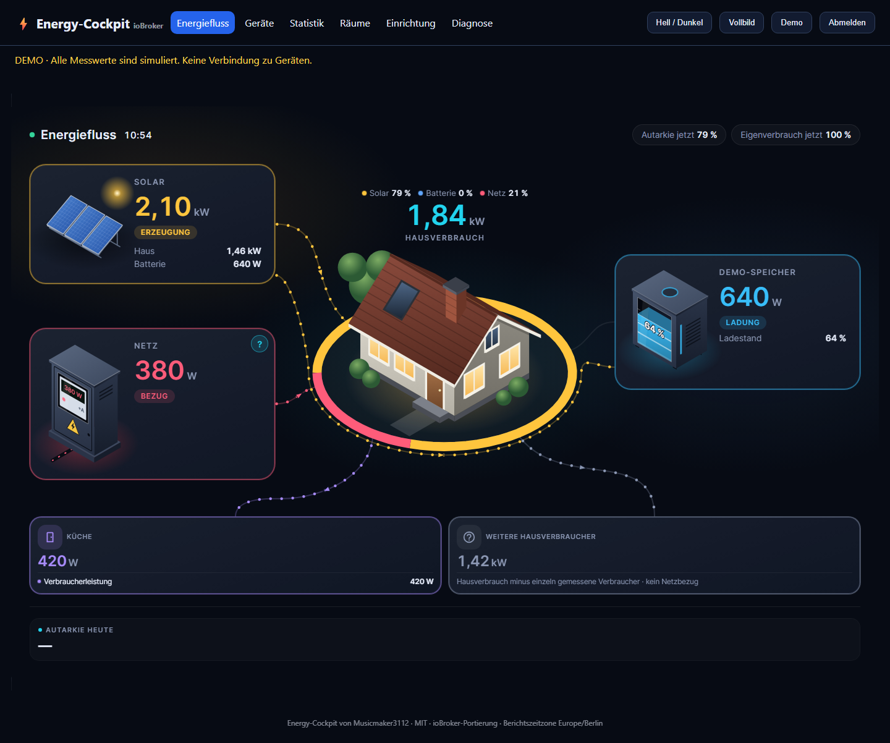

# ioBroker Energy-Cockpit

Native ioBroker adapter built from the actual [Energy-Cockpit](https://github.com/msucimaker3112/energy-cockpit) source by Musicmaker3112. The original animated energy flow, SVG 3D house, battery graphics, devices, room and statistics cards run as standalone web components.

**Status: 0.1.0-alpha.6, integration candidate.** This is not a declaration that all requested production acceptance criteria have passed. See [TEST_REPORT.md](TEST_REPORT.md) for executed checks and remaining limits.

The German interface provides a ten-step setup wizard, searchable ioBroker datapoints, source-unit conversion, independent battery profiles, a live preview and data-quality diagnostics. The backend uses adapter-core subscriptions and the existing history adapter's `getHistory` / read-only InfluxDB `query` APIs. No direct access to ioBroker databases and no Home Assistant server are required.

HTTPS uses the installation's ioBroker certificates. Login accepts the ioBroker administrator or a separately provisioned Cockpit password. Configuration changes require an authenticated session and CSRF token. Device control is disabled in this initial release.

Missing, stale or invalid source values are unavailable, never replaced with demo readings. Demo mode is explicit and has no device access. Original Home Assistant weather, calendar and service integrations are not emulated.

- [Installation](INSTALL.md) and [Docker deployment](DOCKER_DEPLOYMENT.md)
- [Configuration](CONFIGURATION.md) and [architecture](ARCHITECTURE.md)
- [Development](DEVELOPMENT.md), [test report](TEST_REPORT.md), [rollback](ROLLBACK.md)
- [Batter4802](BATTER4802.md), [source provenance](docs/UPSTREAM.md), [sanitized environment](docs/ENVIRONMENT.md)

MIT. Original copyright (c) 2026 Musicmaker3112 is preserved. New ioBroker integration copyright (c) 2026 Landixus. Bundled Material Design Icons are Apache-2.0 licensed; the icon license ships with the build. System fonts are used; no font CDN is required.
